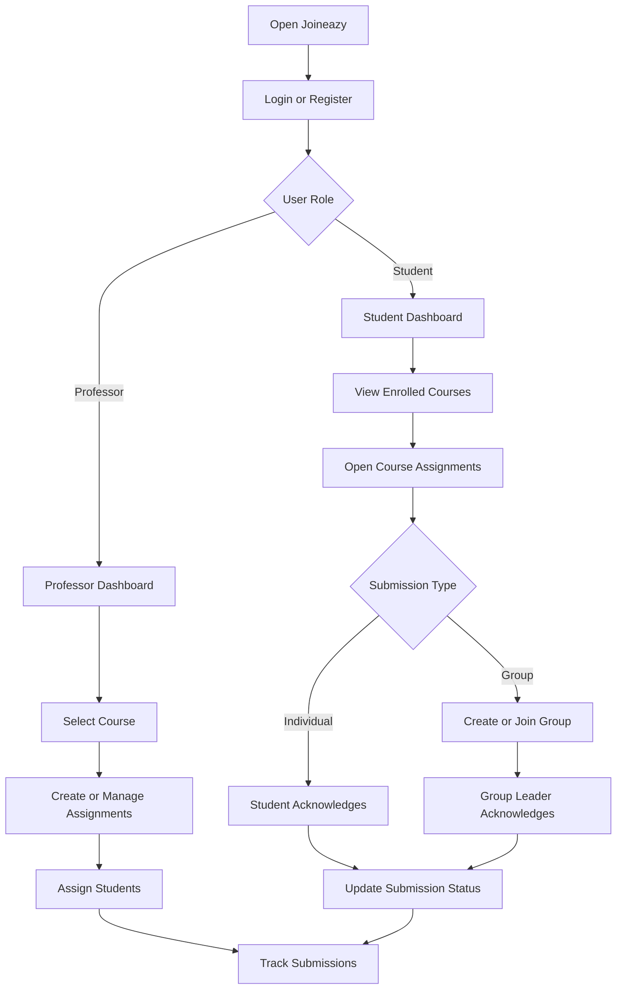

# Joineazy – Assignment & Review Dashboard

A course-based assignment management platform that connects professors and students through a centralized dashboard. Joineazy helps professors distribute assignments, monitor student progress, and manage group submissions while allowing students to access coursework and acknowledge completed assignments.

**Developed as part of the Joineazy Frontend Internship – Task 1 and Task 2.**

---

## 1. Project Overview

Managing academic assignments involves distributing tasks, tracking deadlines, monitoring submissions, and coordinating group activities. Joineazy brings these activities together in one platform.

The application provides two role-based portals:

- **Professor Portal:** Manage course assignments, assign students, monitor submissions, and track class progress.
- **Student Portal:** Access enrolled courses, view assignments, manage groups, and acknowledge submissions.

Joineazy is a frontend application built with React.js. It uses simulated authentication and browser LocalStorage for data persistence.

## 2. Project Evolution – Task 1 and Task 2

### Task 1 – Assignment & Review Dashboard

The initial version focused on basic assignment management.

- Professor and student dashboards.
- Create, edit, and delete assignments.
- Assign tasks to students.
- View assignment deadlines.
- Individual submission acknowledgment.
- Track submitted and pending assignments.
- Search and filter assignments.

### Task 2 – Course-Based Assignment Management

The second version extends the application with course-specific workflows and group collaboration.

- Student and professor registration and login.
- Role-based dashboards and protected application access.
- Course-based assignment management.
- Individual and group submission types.
- Group creation and joining.
- Group leader and member management.
- Leader-only acknowledgment for group assignments.
- Submission timestamps and acknowledgment details.
- Overdue assignment identification.
- Detailed submission tracking for professors.
- Persistent data after browser refresh.

## 3. Application Workflow



## 4. Features

### Professor Portal

- View courses assigned to the professor.
- Open a course to manage its assignments.
- Create assignments with title, description, deadline, and OneDrive link.
- Select Individual or Group submission.
- Assign work to selected students.
- Edit and delete assignments.
- Search and filter assignments.
- View submission progress and completion percentages.
- View detailed submitted and pending lists.
- Monitor individual students and groups.

### Student Portal

- View enrolled courses.
- Access course-specific assignments.
- View descriptions, deadlines, and resource links.
- Acknowledge individual assignments.
- View acknowledgment status and timestamps.
- Identify overdue assignments.
- Search and filter assignments.
- See an empty state when no courses are assigned.

### Group Management

- Create a group within a course.
- Group creator automatically becomes the leader.
- Join an existing group.
- View group leaders and members.
- Only the group leader can acknowledge a group assignment.
- All group members can view the acknowledgment details.
- Students without a group receive a prompt to create or join one.

### Submission Tracking

- Track individual and group submissions.
- Display submitted and pending counts.
- Show progress bars and completion percentages.
- Display acknowledgment timestamps.
- Identify overdue assignments.
- Preserve submission records after refreshing the browser.

### User Experience

- Responsive desktop, tablet, and mobile layouts.
- Role-specific dashboards.
- Form validation and error messages.
- Toast notifications.
- Confirmation dialogs.
- Loading and empty states.
- Status indicators and progress bars.

## 5. Technology Stack


| Technology | Purpose |
|---|---|
| React.js | Frontend development |
| Vite | Development server and build tool |
| JavaScript | Application logic |
| Tailwind CSS | Utility-based styling |
| CSS3 | Additional component styling |
| React Router DOM | Navigation |
| React Context API | Shared state management |
| LocalStorage | Browser-based data persistence |
| Simulated JWT | Frontend authentication |
| Git and GitHub | Version control |

## 6. Project Architecture

The application follows a component-based React architecture.

- **Components:** Reusable assignment, course, group, and common UI components.
- **Pages:** Separate professor, student, authentication, and course pages.
- **Context:** Centralized authentication and application state.
- **Data:** Initial users, courses, groups, and assignments.
- **Utilities:** LocalStorage initialization and data management.

## 7. Project Structure

```text
Joineazy/
│
├── public/
│
├── src/
│   ├── assets/
│   │
│   ├── components/
│   │   ├── assignments/
│   │   │   ├── AssignmentCard.jsx
│   │   │   ├── AssignmentModal.jsx
│   │   │   └── DrillDownModal.jsx
│   │   │
│   │   ├── common/
│   │   │   ├── Icons.jsx
│   │   │   ├── ProgressBar.jsx
│   │   │   └── Toast.jsx
│   │   │
│   │   ├── courses/
│   │   │   └── CourseCard.jsx
│   │   │
│   │   ├── groups/
│   │   │   └── GroupManagerModal.jsx
│   │   │
│   │   ├── AssignmentCard.css
│   │   ├── AssignmentCard.jsx
│   │   ├── Navbar.jsx
│   │   ├── StatsOverview.css
│   │   ├── StatsOverview.jsx
│   │   ├── SubmitModal.css
│   │   ├── SubmitModal.jsx
│   │   ├── Toast.css
│   │   └── Toast.jsx
│   │
│   ├── context/
│   │   ├── AppContext.jsx
│   │   └── AuthContext.jsx
│   │
│   ├── data/
│   │   ├── initialAssignments.js
│   │   ├── initialData.js
│   │   └── mockUsers.js
│   │
│   ├── pages/
│   │   ├── admin/
│   │   │   ├── AdminDashboard.css
│   │   │   └── AdminDashboard.jsx
│   │   │
│   │   ├── student/
│   │   │   ├── StudentDashboard.css
│   │   │   └── StudentDashboard.jsx
│   │   │
│   │   ├── AuthPage.jsx
│   │   ├── CourseAssignmentsPage.jsx
│   │   └── CoursesDashboard.jsx
│   │
│   ├── utils/
│   │   ├── initStorage.js
│   │   └── storage.js
│   │
│   ├── App.jsx
│   ├── App.css
│   ├── index.css
│   └── main.jsx
│
├── index.html
├── package.json
├── package-lock.json
├── vite.config.js
└── README.md
```

## 8. Getting Started

### Prerequisites

- Node.js
- npm
- Git

### Clone the Repository

```bash
git clone YOUR_GITHUB_REPOSITORY_URL
```

### Navigate to the Project

```bash
cd Joineazy
```

### Install Dependencies

```bash
npm install
```

### Start the Development Server

```bash
npm run dev
```

Open the local URL displayed in the terminal.

### Create a Production Build

```bash
npm run build
```

## 9. Demo Login

Joineazy provides demo login options for testing both user roles.


| Role | Demo Email |
|---|---|
| Professor | professor@joineazy.com |
| Student | student@joineazy.com |


Use the **Professor Demo** or **Student Demo** option on the login page to access the respective dashboards.

Users can also register through the application.

## 10. Data Persistence and Limitations

Joineazy uses browser LocalStorage to maintain application data.

- Authentication session information is stored locally.
- Course and assignment information is persisted.
- Group information is stored locally.
- Submission statuses and timestamps are retained.
- Changes remain available after refreshing the browser.

**Important:** Authentication is simulated for demonstration purposes. There is no backend server or production-grade authentication. LocalStorage data is browser-specific and is not synchronized across different devices.

## 11. Responsive Design

The application supports desktop, tablet, and mobile screen sizes. Its responsive layouts help professors and students access the platform across different devices.

## 12. Project Objective

The objective of Joineazy is to simplify academic assignment management through a centralized platform. By combining course-based assignment distribution, group collaboration, submission acknowledgment, and progress tracking, the application provides a structured workflow for professors and students.

## 13. Project Links

- **GitHub Repository:** To be added
- **Live Application:** To be added
- **Demo Video:** To be added

## 14. Internship Details

- **Company:** Joineazy
- **Role:** Frontend Intern
- **Task 1:** Assignment & Review Dashboard
- **Task 2:** Course-Based Assignment Management and Group Collaboration
- **Frontend:** React.js, Vite, JavaScript, Tailwind CSS
